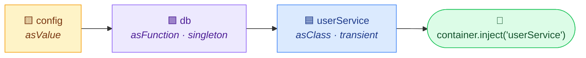

<div align="center">

# 🧩 Dependor

### Know your dependencies. Wire them up right.

**Two tools, one repo:** a CLI that tells you how risky an npm package is *before* you install it,<br/>
and **Wireup**, a tiny type-safe dependency injection container for TypeScript.

<br/>

[](https://www.npmjs.com/package/@wireupjs/core)
[](https://bundlephobia.com/package/@wireupjs/core)
[](./dependor-di/package.json)
[](./dependor-di/src)

[](https://nodejs.org/)
[](./dependor-di/test)
[](./dependor-di/LICENSE)

[](https://github.com/Bankai11/dependor/actions/workflows/ci-library.yml)
[](https://github.com/Bankai11/dependor/actions/workflows/ci-cli.yml)
[](https://github.com/Bankai11/dependor/actions/workflows/ci-website.yml)

<br/>

[**⚡ Wireup quick start**](#-wireup-dependency-injection-without-the-magic) •
[**🔍 Dependor CLI**](#-dependor-cli-check-before-you-install) •
[**🗂️ What's in this repo**](#️-whats-in-this-repo) •
[**🛠️ Development**](#️-development)

</div>

---

## 🗂️ What's in this repo

| | Project | Folder | What it is |
|:-:|---|---|---|
| ⚡ | **Wireup** (`@wireupjs/core`) | [`dependor-di/`](./dependor-di/) | Zero-dependency DI container for Node.js & TypeScript. **[Live on npm](https://www.npmjs.com/package/@wireupjs/core)** |
| 🔍 | **Dependor CLI** | repo root (`bin/`, `lib/`) | Risk analyzer that scores any npm package before you install it |
| 🌐 | **Wireup website** | [`website/`](./website/) | Docs and trust site, built with Next.js 16 |

---

## ⚡ Wireup: dependency injection without the magic

> [!TIP]
> **No decorators. No reflection. No `reflect-metadata`.** You describe your app's graph in plain code,
> Wireup checks it once at startup, and `inject()` gives you back fully typed instances.

### 📦 Install

```sh
npm install @wireupjs/core
```

### 🚀 30-second example

```ts
import { asClass, asFunction, asValue, createContainer } from '@wireupjs/core';

class Database {
  constructor(readonly url: string) {}
}

class UserService {
  constructor(private readonly db: Database) {}
  list() { return `users from ${this.db.url}`; }
}

const container = createContainer({
  config:      asValue({ url: 'postgres://localhost/app' }),
  db:          asFunction((c: { url: string }) => new Database(c.url)).dependsOn('config').singleton(),
  userService: asClass(UserService).dependsOn('db'),
});

const users = container.inject('userService'); // ✅ typed as UserService
users.list();

container.inject('nope');                      // ❌ compile error: not registered
```

### 🧠 How it fits together



### ✨ Why you'll like it

| | Feature | What it means for you |
|:-:|---|---|
| 🪶 | **Tiny** | ~6 KB of readable, unminified JS. **Zero** runtime dependencies. |
| 🔒 | **Type-safe end to end** | `inject('x')` returns the right type, and typos don't compile. |
| 💥 | **Fails fast** | Missing deps and cycles throw at startup, with the full path: `a → b → a`. |
| ♻️ | **Lifetimes** | `.singleton()` for one shared instance, `.transient()` (default) for a fresh one each time. |
| 🧊 | **Immutable** | Definitions and the container are frozen, so nothing can be monkey-patched later. |
| 🧪 | **Easy to test** | Your classes are plain classes. Test them with or without the container. |
| 📦 | **ESM + CommonJS** | Works with `import` and `require`, and ships `.d.ts` for both. |

### 🧰 The whole API at a glance

| Builder | You get | Default lifetime |
|---|---|---|
| 🟨 `asValue(v)` | `v` itself | always singleton |
| 🟪 `asFunction(fn)` | `fn(...deps)` | transient |
| 🟦 `asClass(C)` | `new C(...deps)` | transient |

Chain any of them with **`.dependsOn(...names)`**, **`.singleton()`** or **`.transient()`**.
The container gives you **`inject(name)`**, **`has(name)`** and **`names()`**.

<details>
<summary><b>🚨 Error types (click to expand)</b></summary>

<br/>

| Error | Thrown when |
|---|---|
| `InvalidDefinitionError` | A definition is malformed or uses a reserved name (`__proto__`, `constructor`, …) |
| `UnknownDependencyError` | Something `dependsOn` a name that isn't registered |
| `CircularDependencyError` | The graph has a cycle. `error.path` shows it, e.g. `['a', 'b', 'a']` |

All three extend `DependorError`, so a single `instanceof` check catches any wiring problem.
Errors thrown by **your** factories are passed through untouched.

</details>

📖 **Full docs, API reference & security notes → [`dependor-di/README.md`](./dependor-di/README.md)**

---

## 🔍 Dependor CLI: check before you install

> [!WARNING]
> That innocent-looking package might pull in conflicting peers, an abandoned maintainer,
> or a codebase you can never rip out again. **Dependor tells you before `npm install` does.**

### 📦 Install (from source)

```sh
git clone https://github.com/Bankai11/dependor.git
cd dependor
npm install
npm link          # optional: makes `dependor` available everywhere
```

### ▶️ Use it

```sh
dependor check lodash
dependor check express
dependor check left-pad
```

```text
==================================
  🔍 DEPENDOR ANALYSIS REPORT
==================================

Package:               lodash
Conflict Risk:         12%
Behavioral Complexity: 48
Maintainer Risk:       21
Rollback Difficulty:   35

Final Risk Score: 28 / 100
==================================
```

### 🚦 Reading the score

| Score | Verdict | |
|:-:|---|---|
|  | ✅ **Low risk** | Safe to install |
|  | ⚠️ **Medium risk** | Review it first |
|  | 🚨 **High risk** | Look for alternatives |

### 🧪 What it analyzes

| | Analyzer | What it checks |
|:-:|---|---|
| 🧩 | **Conflict Predictor** | Version-range clashes and peer-dependency mismatches across transitive deps |
| 🧬 | **Behavioral Fingerprinter** | Tarball structure, file entropy and entry-point complexity |
| 📊 | **Multi-Dimensional Scorer** | Weighted risk from maintainer activity, download trends and more |
| 🧯 | **Rollback Simulator** | How hard the package would be to remove later |
| 🔄 | **Alternative Generator** | Native-code alternatives so you can skip the dependency entirely |

<details>
<summary><b>🧮 How the final score is calculated</b></summary>

<br/>

```text
Final Risk Score =
    Conflict Risk          × 0.20
  + Behavioral Complexity  × 0.20
  + Maintainer Risk        × 0.30
  + Rollback Difficulty    × 0.30
```

Every input is normalized to 0–100 first. The CLI needs internet access because it reads live data from the npm registry.

</details>

---

## 🛠️ Development

<details>
<summary><b>📁 Repo layout</b></summary>

<br/>

```text
dependor/
├── 🔍 bin/dependor.js              CLI entry point (yargs)
├── 🔍 lib/                         CLI analyzers
│   ├── conflict-predictor.js
│   ├── behavioral-fingerprint.js
│   ├── multi-dimensional-scorer.js
│   ├── rollback-simulator.js
│   └── alternative-generator.js
├── ⚡ dependor-di/                  @wireupjs/core library (TypeScript)
├── 🌐 website/                     Wireup docs site (Next.js 16)
└── ⚙️ .github/workflows/           CI for each project + npm publish
```

</details>

| Project | Commands |
|---|---|
| ⚡ **Library** | `cd dependor-di && npm ci && npm run check` (typecheck, tests, build, pack) |
| 🔍 **CLI** | `npm install && npm start -- check <package>` |
| 🌐 **Website** | `cd website && npm ci && npm run dev` |

Each project has its own path-filtered CI workflow, so a change in one doesn't trigger the others.
Library releases ship from [`publish.yml`](./.github/workflows/publish.yml) when a GitHub release is published.

🔐 Found a security issue? See [`dependor-di/SECURITY.md`](./dependor-di/SECURITY.md).

---

<div align="center">

**Made with ☕ and 🧩 by [Bankai11](https://github.com/Bankai11)** · MIT licensed

⭐ **If this saved you from a bad dependency, star the repo!** ⭐

</div>
